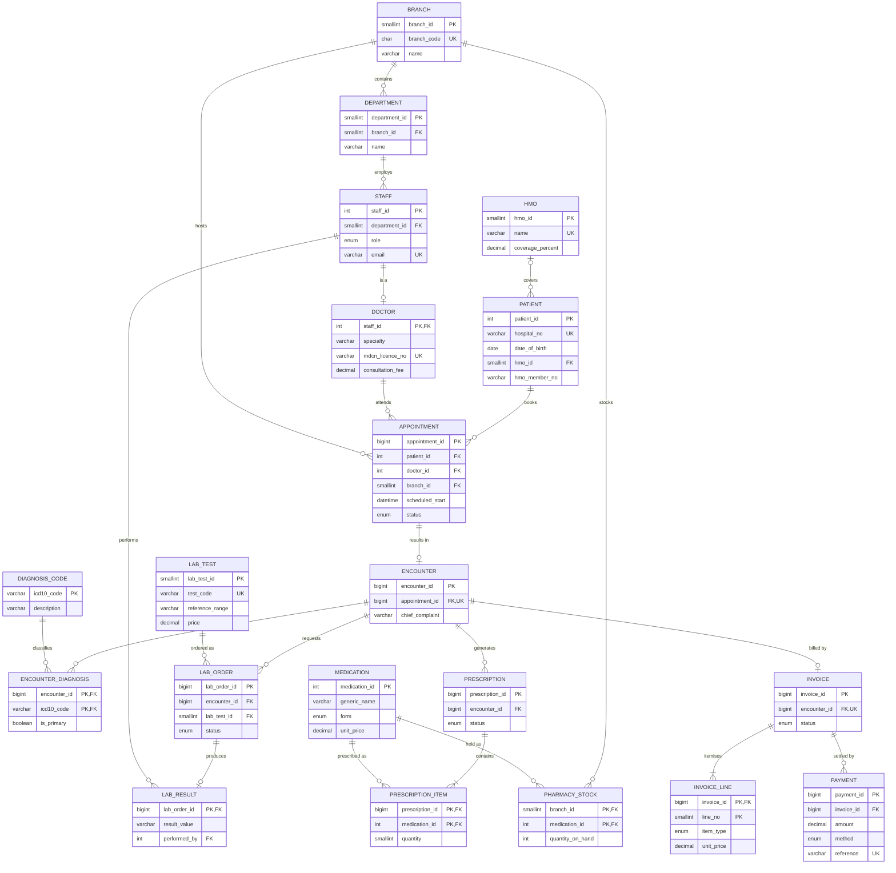

# LagosCare Clinics — ER Diagram

Crow's-foot notation. GitHub renders this diagram automatically. A second version reverse-engineered from the live database in MySQL Workbench is saved as `evidence/eer_diagram_workbench.png`.

