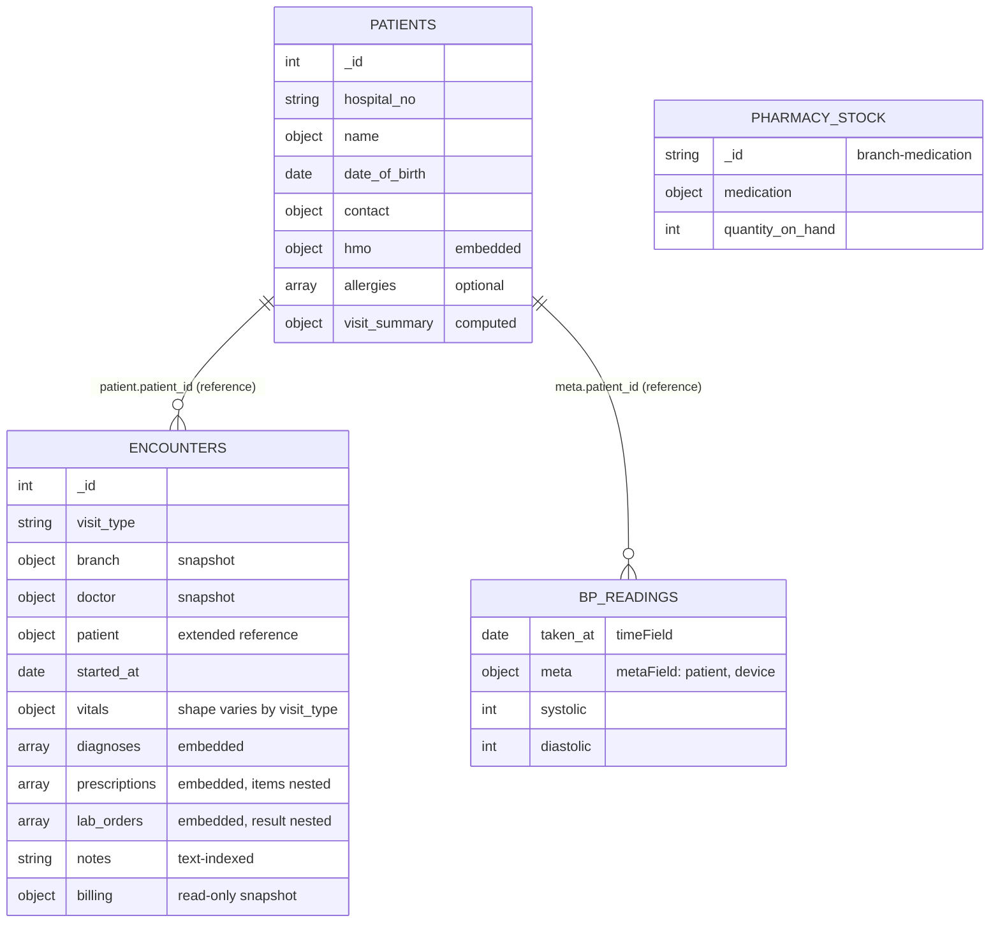

# Portfolio 4 — NoSQL and Advanced Data Models

**Case study:** LagosCare Clinics (same data as Portfolios 1–3, migrated from MySQL)
**NoSQL database:** MongoDB 8.0 (document store), MongoDB Shell (`mongosh`), MongoDB Compass, MongoDB Database Tools

This portfolio remodels the clinic's clinical data as **documents**, loads the real Portfolio 1–3 data into MongoDB, and tests it with queries, indexes, updates, a multi-document transaction and schema validation. It also uses a second advanced model: a **time-series collection** for home blood-pressure monitoring. Billing stays in MySQL; section 5 explains why.

---

## 1. Files

| File | Purpose |
|---|---|
| `01_export_encounters.sql` | MySQL → one JSON document per consultation (9 tables combined) |
| `01_export_patients.sql` | MySQL → one JSON document per patient (HMO embedded, visit summary) |
| `01_export_stock.sql` | MySQL → pharmacy stock documents (for the transaction demo) |
| `02_create_collections.js` | Creates the collections with `$jsonSchema` validators |
| `03_import.cmd` | Loads the JSON files with `mongoimport` |
| `04_queries_indexes.js` | Six query types; `explain("executionStats")` before/after five kinds of index |
| `05_updates_transactions.js` | Atomic array update, schema evolution, validation failures, multi-document transaction |
| `06_timeseries_bp.js` | Time-series collection, weekly averages, rolling-average alert |
| `data/` | Generated JSON (**not committed**: `encounters.json` is ~112 MB, above GitHub's 100 MB limit; regenerate with step 2) |
| `evidence/` | Captured output and screenshots |

## 2. How to run (Windows)

1. Install **MongoDB Community Server 8.0** (as a Windows service), **MongoDB Shell (mongosh)** and **MongoDB Database Tools**, and add the tools' `bin` folder to `PATH`. Compass is installed with the server and is useful for screenshots.
2. Export from MySQL. The database must contain Portfolios 1–3. From this folder:
   ```
   mkdir data evidence
   mysql -u root -p -N -r lagoscare < 01_export_encounters.sql > data\encounters.json
   mysql -u root -p -N -r lagoscare < 01_export_patients.sql   > data\patients.json
   mysql -u root -p -N -r lagoscare < 01_export_stock.sql      > data\pharmacy_stock.json
   ```
3. `mongosh "mongodb://localhost:27017" 02_create_collections.js`
4. `03_import.cmd`. Expect 20,008 patients, 95,744 encounters and 14 stock documents, with **0 failed**.
5. `mongosh "mongodb://localhost:27017" 04_queries_indexes.js > evidence\queries_output.txt`
6. `mongosh "mongodb://localhost:27017" 05_updates_transactions.js > evidence\updates_output.txt`. U4 needs a replica set; see section 4.
7. `mongosh "mongodb://localhost:27017" 06_timeseries_bp.js > evidence\timeseries_output.txt`

**Using MongoDB Atlas instead of a local server.** Steps 2–7 are the same, but you replace `mongodb://localhost:27017` with your Atlas connection string, `mongodb+srv://<user>@<cluster>.mongodb.net/`. Before step 4, `set MONGO_URI=mongodb+srv://<user>:<password>@<cluster>.mongodb.net/lagoscare`. Atlas clusters are already replica sets, so U4's transaction runs without the `mongod.cfg` change. On the free M0 tier, collection storage statistics may be unavailable; the scripts print a note and continue.

## 3. Document model



A shortened encounter document (antenatal visit):

```json
{ "_id": 3, "visit_type": "ANTENATAL",
  "branch":  { "code": "LEK", "name": "LagosCare Lekki" },
  "doctor":  { "staff_id": 7, "name": "Dr Aisha Bello", "specialty": "Obstetrics & Gynaecology" },
  "patient": { "patient_id": 4, "hospital_no": "LC-000004", "name": "Halima Yusuf", "sex": "F", "age_at_visit": 35, "hmo": "Crestline HMO" },
  "started_at": { "$date": "2026-11-03T10:04:00Z" },
  "vitals": { "bp": { "systolic": 136, "diastolic": 67 }, "pulse_bpm": 104, "temperature_c": 37.7,
              "gestational_age_weeks": 15, "fetal_heart_rate_bpm": 122 },
  "diagnoses":  [ { "icd10": "Z34.9", "description": "Supervision of normal pregnancy, unspecified", "primary": true } ],
  "lab_orders": [ { "lab_order_id": 3, "test_code": "PCV", "status": "COMPLETED",
                    "result": { "value": "34", "unit": "%", "reference_range": "36-50", "abnormal": true } },
                  { "lab_order_id": 5, "test_code": "URN", "status": "ORDERED" } ],
  "prescriptions": [ { "prescription_id": 3, "status": "DISPENSED",
                       "items": [ { "medication": "Folic Acid 5mg", "quantity": 30, "frequency": "Once daily" } ] } ],
  "notes": "Fundal height appropriate. PCV requested.",
  "billing": { "invoice_id": 3, "status": "PAID", "total": { "$numberDecimal": "26800.00" } } }
```

MySQL returns JSON keys sorted by length, so the exported files list fields in a different order. Field order has no effect in MongoDB.

### Design decisions: embed or reference?

| Relationship | Decision | Reason |
|---|---|---|
| Encounter → diagnoses, prescriptions (+items), lab orders (+result) | **Embed** | Small and bounded per visit, always read and written with the visit, and never queried without it. One read returns the whole consultation. |
| Patient → HMO plan | **Embed** | At most one, always displayed with the patient. |
| Patient → encounters | **Reference** (`patient.patient_id`) | Grows without limit; embedding would eventually reach the 16 MB document cap and make every patient read heavy. |
| Encounter → patient, doctor, branch | **Extended reference** (copy of a few fields) | The clinic's list views need the name and hospital number without a `$lookup`. These fields rarely change; if a name is corrected, an `updateMany` on `patient.patient_id` fixes the copies. |
| Patient → `visit_summary` | **Computed pattern** | The visit count and last visit are pre-calculated for the front-desk search and updated when an encounter is added (U2). |
| Encounter → `billing` | **Snapshot only** | Shown to clinicians for information; MySQL remains the source of truth (section 5). |
| Vitals | **Polymorphic sub-document** | Antenatal, paediatric and adult visits record different measurements (table below). |

Shapes of `vitals` in the imported data, checked on all 95,744 documents:

| visit_type | vitals fields | documents |
|---|---|---:|
| GENERAL / MEDICAL | temperature, pulse, SpO₂, weight, **bp** | 59,857 |
| PAEDIATRIC | temperature, pulse, SpO₂, weight, **resp_rate** (no BP) | 23,984 |
| ANTENATAL | adult set + **gestational_age_weeks**, **fetal_heart_rate** (12+ weeks), **fundal_height** (20+ weeks) | 11,903 |

In MySQL this would need either many nullable columns or separate vitals tables per visit type. Vitals were not part of the Portfolio 1 relational design, which listed them as a reason for this portfolio. The export generates them deterministically from the encounter ID.

### Validation (schema-flexible, not schema-less)
`02_create_collections.js` attaches `$jsonSchema` validators. The validators enforce required identity fields, BSON types (dates are real dates and money is `Decimal128`, never floating point), enums (visit type, lab status, branch), value ranges (temperature 30–45 °C, BP limits, stock ≥ 0), the hospital-number pattern, and at least one diagnosis per encounter. Optional and new fields stay allowed. U3 shows five invalid documents being rejected.

## 4. Queries, indexes, updates and transactions

| # | Business question | Feature | Index |
|---|---|---|---|
| M1 | Full history of one patient, newest first | Single query replaces a 9-table join | Compound `{patient.patient_id, started_at:-1}` (equality + sort) |
| M2 | Lekki encounters in the last 30 days with an abnormal lab result, showing only those results | `$elemMatch`, `$filter` | Compound `{branch.code, started_at:-1}` |
| M3 | Antenatal visits ≥ 20 weeks with systolic ≥ 140 (pre-eclampsia screen) | Fields that exist only in some documents | **Partial** index, `visit_type: "ANTENATAL"` only |
| M4 | Top 5 primary diagnoses per branch; monthly malaria trend | `$unwind`, `$group`, `$topN`, `$dateTrunc` | **Multikey** `{diagnoses.icd10, started_at}` |
| M5 | Search notes for "wheeze inhaler" | Relevance-ranked text search | **Text** index (complaint weighted ×2) |
| M6 | Penicillin-allergic patients seen in the last 30 days | `$lookup` with a sub-pipeline | Multikey `{allergies}` + `ix_patient_started` |

Results from my final run (after the timezone label fix) on **MongoDB Atlas (free M0 cluster, replica set `atlas-26pdm4-shard-0`)**, from `evidence/queries_output.txt`:

| Query | Before: plan | Docs examined | ms | After: plan | Keys / docs examined | ms |
|---|---|---:|---:|---|---:|---:|
| M1 patient history | COLLSCAN → SORT | 95,745 | 148 | IXSCAN `ix_patient_started` (no SORT) | 6 / 6 | 0 |
| M2 abnormal labs, Lekki, 30 days | COLLSCAN → SORT | 95,745 | 92 | IXSCAN `ix_branch_started` (no SORT) | 3,840 / 3,840 | 12 |
| M3 antenatal BP screen | COLLSCAN → SORT | 95,745 | 88 | IXSCAN `ix_antenatal_bp` (partial, no SORT) | 342 / 311 | 1 |
| M3 without `visit_type` | — | — | — | COLLSCAN (partial index not eligible) | 0 / 95,745 | 88 |
| M4b malaria by month | — | — | — | IXSCAN `ix_diagnosis_started` → PROJECTION_COVERED | 6,534 / **0** | 41 |
| M5 text search | — | — | — | TEXT_MATCH on `ix_notes_text` | 9,736 / 4,868 | 40 |

Index sizes: `_id_` 3.7 MB, `ix_patient_started` 1.3 MB, `ix_branch_started` 1.1 MB, `ix_diagnosis_started` 1.6 MB, **`ix_antenatal_bp` 0.09 MB** (partial: only ~12% of documents), **`ix_notes_text` 10.1 MB** (one entry per distinct word per document, the most expensive index here).

Timings on the shared free tier vary between runs (M1 before: 84 ms in the first run, 148 ms in this one); the plans and document counts are identical every time.

**Analysis**
- **M1.** The collection scan read all 95,745 documents to return 6. The compound index reads exactly 6 keys and 6 documents. Because the index is already in `started_at` descending order, the in-memory **SORT stage disappears**.
- **M2.** The index narrows the search to Lekki's last 30 days (3,840 documents). The `$elemMatch` on abnormal results is then checked on those documents only, leaving 386. A wider index including `lab_orders.result.abnormal` would read fewer documents, at the cost of a larger multikey index on every encounter. For a daily worklist, 12 ms is acceptable.
- **M3.** The partial index holds antenatal documents only, which is why it is 0.09 MB against 1–1.6 MB for the full indexes. Without `visit_type: "ANTENATAL"` in the filter, MongoDB cannot prove the index contains every match and falls back to COLLSCAN (88 ms). Partial indexes trade generality for size.
- **M4b.** **Covered query**: `docsExamined: 0`. Every field the pipeline needs (`diagnoses.icd10`, `started_at`) is in the index, so no document is read. This is the document-store equivalent of Portfolio 2's covering index (Q4).
- **M5.** The text index makes free-text search possible at all (`$text` requires it). It is also the largest index, so it should only exist if notes search is a real requirement.
- **M6.** `$lookup` works (644 penicillin-allergic patients seen in the last 30 days), but it is the exception: every other query reads a single collection, because the model embeds what is read together.

What to point out: the drop in documents examined; the disappearance of the in-memory `SORT` stage for M1 and M3; and that M3 **without** `visit_type` cannot use the partial index, because the index only promises antenatal documents.

**Atomicity.**
- **U1, single document.** Recording a lab result changes the status and adds the result inside one array element with a single `updateOne` (`arrayFilters`). MongoDB writes one document atomically, so readers never see a half-recorded result. Embedding keeps most clinical writes to one document and therefore atomic without a transaction.
- **U4, multi-document transaction.** Dispensing touches two stock documents and the encounter. Each stock update is guarded (`quantity_on_hand: {$gte: qty}`, the same rule as the MySQL CHECK). Attempt (a) commits. Attempt (b) fails on its second item, and `abortTransaction()` undoes the first item's change, the same all-or-nothing behaviour as `sp_dispense_prescription` in Portfolio 3.

  Transactions need a **replica set**. To turn the local Windows service into a one-node replica set:
  1. Edit `C:\Program Files\MongoDB\Server\8.0\bin\mongod.cfg` and add
     ```yaml
     replication:
       replSetName: rs0
     ```
  2. Restart the **MongoDB** service (services.msc).
  3. In mongosh, run `rs.initiate()`.

  Portfolio 5 builds on this replication setup.

**Schema evolution.** U2 adds a telemedicine consultation with a new `telemedicine` sub-document. The 95,744 existing documents are untouched and still valid; no `ALTER TABLE` or migration is needed. U2 also updates the patient's computed `visit_summary`. In production, those two writes would go in one transaction (as U4 does) or be accepted as briefly inconsistent.

## 5. Suitability: where MongoDB fits this clinic, and where it does not

**Good fit: clinical records**
- A consultation is naturally one self-contained record that clinicians read whole. The document model returns it in one read (M1); MySQL needs a 9-table join.
- Content varies by visit type (antenatal, paediatric, adult) and changes over time (telemedicine). Optional fields absorb that without migrations or sparse columns.
- Free-text notes need text search (M5). Arrays such as diagnoses and allergies are first-class and indexable (multikey).
- Device data (home BP) is append-only time-series data, a native collection type with compression and window functions.

**Poor fit: money and stock, so these stay in MySQL**
- Invoices, payments and stock balances are shared, highly contended records whose correctness depends on cross-record constraints: no overpayment, a status that matches the payments, stock never negative under concurrent dispensing. Portfolio 3 enforces these with foreign keys, CHECK constraints and row locks. MongoDB can do it with multi-document transactions, but that gives up much of the document model's advantage, and it has no foreign keys.
- Management reporting across many entities (revenue by branch, HMO receivables) is simpler with joins and SQL aggregates.
- Duplicated snapshot fields (patient name, doctor name, billing summary) must be kept in sync by the application. That is the price of fast reads.

**Conclusion: polyglot persistence.**
- **MySQL**: system of record for patients, appointments, billing, stock and payments.
- **MongoDB**: clinical record (encounters), patient-facing reads, notes search and device time-series.

In a live system, changes would flow from MySQL to MongoDB through change data capture or an outbox table. This portfolio does the transfer as a batch export.

**Other NoSQL models considered**

| Model | Clinic use | Why not chosen as the main model |
|---|---|---|
| Key-value (e.g. Redis) | Queue display at reception, session cache, "now serving" counters | Lookup by key only; cannot query clinical content |
| Column-family (e.g. Cassandra) | Very high-volume device readings across many clinics | Overkill for two branches; MongoDB time-series covers this scale (`06_timeseries_bp.js`) |
| Graph (e.g. Neo4j) | Referral networks, infection contact tracing, drug-interaction graphs | Useful for relationship-heavy questions, but the core records are not relationship-centred |

## 6. Other results (from `evidence/`)

| Test | Result |
|---|---|
| Import (`03_import.cmd`) | 20,008 patients, 95,744 encounters, 14 stock documents; 0 failed. Every document passed the validators on insert. |
| Average encounter document | 1,001 bytes |
| U1 lab result | `matchedCount 1, modifiedCount 1`; status and result changed together in one document write |
| U2 schema evolution | 1 encounter with `telemedicine`, 95,744 without; the patient's `visit_summary` updated (0 → 1 visit) |
| U3 validation | 5 of 5 invalid inserts rejected, error code 121 (DocumentValidationFailure), each naming the rule broken: enum, minItems, maximum, pattern, minimum |
| U4 transaction | (a) COMMITTED: LEK-3 450 → 420, LEK-4 700 → 640, prescription 4 DISPENSED. (b) ABORTED on the second item: LEK-3 stayed at 420, so the first item's change was rolled back. |
| T1 time series | 4,800 readings (40 patients × 60 days × 2) stored in 80 buckets; weeks start Sunday 23 Aug 2026; weekly averages show controlled patients falling (e.g. 150/94 → 135/85) and uncontrolled patients flat (~152/95) |
| T2 rolling-average alert | 32 of 40 patients still at or above 135/85 on the 7-day average |

**Issues found during the run and fixed**
- Month and week labels in M4b and T1 were first formatted in UTC. In Lagos time a month starts at 23:00 UTC the previous day, so October was labelled September. The labels now use `timezone: "Africa/Lagos"`; the counts were already correct.
- The Atlas free tier reports a nominal storage size for the time-series collection (4,096 bytes), so it cannot be used as bytes per reading. The bucket count (80) is the meaningful figure.
- Seed encounter 3 says "Routine antenatal, 20 weeks" in its complaint text, but its generated vitals give `gestational_age_weeks: 15`, because vitals are generated from the encounter ID and do not read the free text. Bulk encounters are consistent; the evidence screenshot uses encounter 21 instead.
- The Portfolio 2 generator picks first names and dates of birth at random, independent of sex and visit type, so some documents are unrealistic (e.g. encounter 21: an antenatal visit for an 80-year-old with a typically male first name). The export only corrects sex for antenatal visits. A production-quality generator would draw names by sex and restrict antenatal visits to ages 15–49. The evidence screenshot is filtered to plausible ages: `{ visit_type: "ANTENATAL", "patient.age_at_visit": { $gte: 18, $lte: 45 } }`.
- Some Portfolio 2 appointments assign male patients to O&G doctors (random generator). The export labels those visits GENERAL without pregnancy fields.

## 7. Evidence checklist (`evidence/`)

- [ ] `import_output.png`: collection counts (20,008 / 95,745 / 14 / 4,800)
- [x] `atlas_cluster_overview.png`: cluster, version 8.0.37, data size 116.86 MB / 512 MB
- [x] `paediatric_document.png`: paediatric vitals (`resp_rate_pm`, no `bp`)
- [x] `antenatal_document.png`: encounter 363, female patient aged 38 at 20 weeks; antenatal vitals (`gestational_age_weeks`, `fetal_heart_rate_bpm`, `fundal_height_cm`)
- [ ] `compass_validation.png`: Compass → encounters → Validation tab
- [x] `updates_output.txt`
- [x] `queries_output.txt`, `timeseries_output.txt` (final run, after the timezone label fix)
- [ ] `compass_explain_m1_before_after.png`: Compass Explain Plan for M1 (COLLSCAN vs IXSCAN)
- [x] Replica set confirmed in `updates_output.txt` (`atlas-26pdm4-shard-0`)

## 8. My notes

<!-- In your own words: which embedding decision you would defend in a
     verification discussion, what surprised you in the explain output, and
     one thing you think should never move out of MySQL. -->
