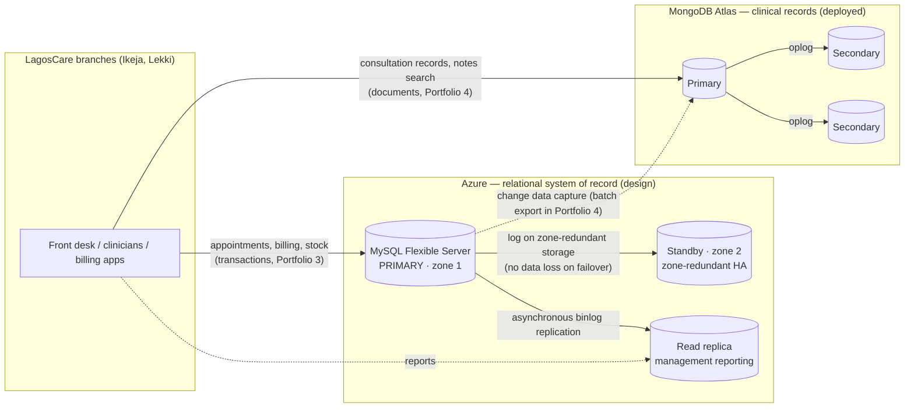

# Portfolio 5 — Distributed and Cloud Database Exercise

**Case study:** LagosCare Clinics (same data as Portfolios 1–4)
**Platforms:** MongoDB Atlas (3-member replica set, AWS Paris, free M0 tier) as the live deployment, and Microsoft Azure Database for MySQL – Flexible Server as the design for the relational system of record

This portfolio deploys the clinic's clinical database in the cloud and tests replication, consistency and availability on the live replica set. It analyses sharding with the real data and designs the Azure deployment for the MySQL billing and appointments database. The free tier's limits are stated honestly where they apply.

---

## 1. Files

| File | Purpose |
|---|---|
| `01_replication_consistency.js` | R1–R7: topology, write-concern latency, unsatisfiable write concern, read-preference routing, stale reads, causally consistent reads, failover readiness |
| `02_shard_key_analysis.js` | Simulates four shard keys on the 95,745 encounters: data spread, write hot spots, query targeting |
| `evidence/` | Script output and Atlas screenshots |

## 2. How to run

From this folder, in a Command Prompt where `MONGO_PW` and `ATLAS` are set (as in Portfolio 4):

```
mkdir evidence
mongosh "%ATLAS%" --username adebowale_db_user --password %MONGO_PW% 01_replication_consistency.js > evidence\replication_output.txt
mongosh "%ATLAS%" --username adebowale_db_user --password %MONGO_PW% 02_shard_key_analysis.js > evidence\sharding_output.txt
```

Script 01 takes about a minute (≈ 800 round trips to Paris). Script 02 only reads data.

## 3. Architecture



The split follows Portfolio 4's conclusion: money, stock and appointments need cross-record constraints and row locks, so they stay relational. Consultation records are document-shaped, so they go to MongoDB.

## 4. Replication and availability (MongoDB Atlas, deployed)

Atlas runs every cluster, including the free M0, as a **3-member replica set**. The primary takes all writes and records them in its **oplog**; the two secondaries copy and replay it. R1 lists the members and the current primary.

**Failover.** If the primary fails, the two remaining members are still a majority (2 of 3), so they elect a new primary, typically within about 10–12 seconds. Drivers use **retryable writes** by default and resend an interrupted write once to the new primary (R7).
- Writes acknowledged with `w:"majority"` survive any failover.
- A `w:1` write that reached only the old primary can be **rolled back**.
- With 3 members the set tolerates **1** failure. Tolerating 2 would need 5 members.

**What the free tier cannot show.** Atlas's *Test Resilience* (forced primary failover) needs a dedicated M10+ cluster. `rs.status()` did work on M0: all three members were healthy, with identical optimes. So failover is evidenced by topology, member health, configuration and the retryable-write design rather than a live test. On an M10 the test would be: start a loop of inserts with `retryWrites=true`, trigger *Test Resilience → Test Primary Failover*, and record the election time and that no acknowledged `majority` write was lost.

## 5. Consistency

| Setting | Meaning | Trade-off |
|---|---|---|
| `w:1` | Primary has the write | Fastest; can be rolled back on failover |
| `w:"majority"` | 2 of 3 members have it | Durable through failover; one extra replication round trip |
| `w:3` | All members have it | Slowest; one slow or down member blocks every write |
| `readPref: primary` | Read from the primary | Always sees the latest committed data |
| `readPref: secondary` | Read from a secondary | Offloads the primary, but may return **stale** data (R5) |
| Causally consistent session + `readConcern: majority` | Secondary waits until it has your earlier write | Read-your-writes on secondaries (R6) |

**CAP / PACELC.**
- **MongoDB:** only the primary accepts writes. During a network partition the minority side cannot elect a primary and stops taking writes, so it chooses **consistency over availability** (CP).
- **MongoDB without a partition:** the application picks the latency/consistency balance per operation. `w:1` with secondary reads favours **latency** (EL); `w:"majority"` with primary or causal reads favours **consistency** (EC).
- **Azure MySQL:** behaves the same way. The HA standby is a hidden failover target that never serves reads, so committed data is not lost. Read replicas are asynchronous, so reports read there can lag.

**Clinic policy that follows from this:**
- Clinical writes (results, prescriptions): `w:"majority"`. A lost lab result is unacceptable.
- Clinician screens straight after saving: primary reads, or a causal session.
- Dashboards and trend reports (Portfolio 4's M4/M4b): `secondaryPreferred`. A few seconds of lag doesn't matter there, and it takes load off the primary.

## 6. Sharding design (simulated on real data)

The free tier cannot shard, and 117 MB doesn't need it. Sharding becomes relevant if LagosCare grows to many branches or years of device data. `02_shard_key_analysis.js` tests four candidate keys against the real 95,745 encounters split across 3 simulated shards.

| Key | Expected behaviour |
|---|---|
| A `{branch.code}` | Only 2 distinct values, so at most 2 chunks **ever**. The third shard stays empty and the data can never spread further. |
| B `{started_at}` (range) | Even over history, but the value only increases, so **every new visit goes to the last shard**, a write hot spot. |
| C `{patient.patient_id: "hashed"}` | ~20,000 distinct values hashed evenly. New writes spread evenly, and M1 (patient history) is **targeted** to one shard. |
| D `{branch.code, patient.patient_id}` + zones | Keeps each branch's data on its own zone (useful if branches were in different regions). Limited to the branch split. |

**Recommendation: C, hashed `patient.patient_id`.**
- The clinic's most frequent query, a patient's history (M1), hits exactly one shard.
- Writes spread evenly. No patient has enough visits to create a jumbo chunk; the script prints the maximum.
- The cost is that branch/date reports (M2, M4) become **scatter-gather** across all shards. Those are analytical queries; they can run on secondaries or the reporting replica, where extra latency is acceptable.
- For the `bp_readings` time-series collection the same reasoning gives `{ "meta.patient_id": "hashed" }`.

## 7. Azure Database for MySQL – Flexible Server (deployment design)

| Decision | Choice | Reason (Microsoft Learn) |
|---|---|---|
| Compute tier | **General Purpose** for production; Burstable B1ms (Azure free account) for development only | Burstable **does not support high availability** |
| High availability | **Zone-redundant HA**: primary in zone 1, standby in zone 2, same region | Standby is provisioned and managed automatically and failover is automatic. Commits are acknowledged after the logs are flushed to zone-redundant storage, so failover loses no committed data, at a cost of about 5–10% extra write latency. Must be chosen **when the server is created**. |
| Reporting | One **read replica** for management reports (Portfolio 2's revenue and no-show queries) | Replicas are **asynchronous** (typically seconds to a couple of minutes behind), allow up to 10 per server, and have **no automatic failover**. Fine for reports, not for clinical reads. |
| Backups | 7–35 days retention; **geo-redundant backup** to the paired region | Regional disaster recovery |
| Region | The nearest Azure region to Lagos that offers zone-redundant HA (check the region list when creating) | Latency, plus Nigerian data-protection requirements for health data |
| Schema compatibility | Every table has a primary key; every foreign key is `RESTRICT` | Azure recommends primary keys to keep replica lag low. It also warns that `ON DELETE CASCADE` with foreign keys can break HA replication (MySQL bug 102586). The Portfolio 1 design already avoids both problems. |
| Connection | Applications use the server name; DNS moves to the new primary after failover | Apps must reconnect and retry, the same retry design as MongoDB in section 4 |

Portfolio 3's locking design (`SELECT … FOR UPDATE` on the invoice, doctor and stock rows) works unchanged here, because all writes still go to a single primary. Read replicas must never be used for those check-then-write operations.

## 8. Security in the cloud

- **Network:** Atlas only accepts connections from IP addresses on the access list (your current IP was added at setup). Azure uses firewall rules or a private virtual network.
- **Encryption:** TLS for all connections (`mongodb+srv://` enforces it), plus encryption at rest by the provider.
- **Least privilege:** the Atlas setup user is an *Atlas Admin*. The application should use a separate user with only `readWrite@lagoscare`. To add one: Atlas → Database & Network Access → Add New Database User → Built-in role *Read and write to any database*, or a specific privilege on `lagoscare`.
- **Secrets:** passwords are entered at run time (`%MONGO_PW%`) and never stored in the repository.

## 9. Results (from `evidence/`, run on 12 Nov 2026)

### Replication and consistency (`replication_output.txt`)

| Test | Result |
|---|---|
| R1 topology | Replica set `atlas-26pdm4-shard-0`, MongoDB 8.0.37. 3 data-bearing members: `shard-00-01` PRIMARY, `shard-00-00` and `shard-00-02` SECONDARY. All health=1 with the same optime. Majority = 2 of 3. |
| R2 write latency (median of 60) | `w:1` **127 ms** · `w:"majority"` **201 ms** · `w:3` **189 ms** |
| R3 `w:5` | Refused immediately: code 100 `UnsatisfiableWriteConcern`, "Not enough data-bearing nodes" |
| R4 routing | `primary` / `primaryPreferred` → always the primary. `secondary` / `secondaryPreferred` → only the two secondaries. `nearest` → all three members. |
| R5 stale reads | 0 of 200 after `w:1`; 0 of 200 after `w:"majority"` |
| R6 causal session | 0 of 200 missed |
| R7 | Retryable writes on (driver default) |

**Analysis**
- **Write concern.** `w:1` is fastest: the primary answers alone. Waiting for a majority added a median of about **74 ms**, roughly 60% more, and much worse tail latency (max 513 ms against 232 ms). That is the price of a write that survives failover.
- **`w:3` against `w:"majority"`.** `w:3` (189 ms) measured slightly *faster* than `w:"majority"` (201 ms), although it waits for more members. All three members are in the same Atlas region, so they apply writes within a few milliseconds of each other. The difference is network noise on the Lagos ↔ Paris link (~115 ms baseline), not a real effect. With a member in another region, `w:3` would be clearly slower.
- **R3** shows MongoDB rejects a durability promise it cannot keep, instead of hanging.
- **R4** proves read preference really changes which server answers. Secondary reads offload the primary, as planned for the clinic's reporting queries (section 5).
- **No stale reads in R5.** Every read from this laptop takes a ~115 ms trip to Paris. Inside the region, a secondary applies the write in a few milliseconds, so it has always caught up before the read arrives. This does **not** prove stale reads are impossible. An application server in the same data centre, a busy primary, or a lagging secondary would expose them. The risk is real but small in this setup, which is why the clinic still uses primary reads, or causal sessions as in R6, for clinical screens.

### Sharding simulation (`sharding_output.txt`)

| Key | Distinct values | All data (3 shards) | New writes, last 30 days | Patient-history query (M1) |
|---|---:|---|---|---|
| A `branch.code` | 2 | 50% / 50% / **0%** (1.50×) | 1.51× | all 3 shards |
| B `started_at` range | 49,434 | 34.6 / 34.4 / 30.9% (1.04×) | **0 / 0 / 100%** (3.00×) | all 3 shards |
| **C `patient_id` hashed** | 19,846 | 34.3 / 33.4 / 32.3% (**1.03×**) | 33.7 / 33.4 / 32.9% (**1.01×**) | **1 shard** |
| D branch + patient zones | — | 50 / 25 / 25% (1.50×) | 1.49× | all 3 (1 if branch is given) |

The busiest patient has only **15** visits, so a hashed patient key cannot create a jumbo chunk.

**Analysis**
- **A** can never use the third shard. With 2 distinct values it is capped at 2 chunks, however much the clinic grows.
- **B** looks perfectly balanced over history (1.04×), but **every one of the 7,615 recent visits went to the last shard**. That is a write hot spot hidden by a balanced-looking total, and the strongest lesson from the simulation.
- **C** is even for both stored data and new writes, and it is the only key that sends the most common clinical query (M1) to a single shard. This confirms the recommendation in section 6.
- **D** shows that patient 1234 has visits at **both** branches (the Portfolio 2 generator assigns patients to doctors at random). A patient-history query under D therefore cannot be limited to one branch's zone. Real patients mostly use one branch, but D would still need the branch in every query.

The routing column is derived from shard-key rules: a query can be targeted only if its filter contains the shard key or its leading field. The data spread and hot-spot figures are computed from the real documents.

## 10. Evidence checklist (`evidence/`)

- [x] `replication_output.txt`
- [x] `sharding_output.txt`
- [ ] `atlas_cluster_overview.png`: reuse from Portfolio 4, or a fresh one
- [ ] `atlas_network_access.png`: IP access list (Database & Network Access)
- [ ] `atlas_database_users.png`: users and roles, including a least-privilege user if added

## 11. My notes

- **Write safety against speed:** waiting for a majority of the 3 Atlas nodes made writes slower (201 ms against 127 ms with `w:1`). For a clinic I'd accept that for lab results and prescriptions, because losing one after a server failure isn't acceptable. Dashboards and reports can use faster settings and read from secondaries.
- **Shard key lesson:** a date-based shard key looked balanced over the whole history (1.04×), but **every** new visit landed on the last shard. That hot spot only showed up when I looked at new writes separately. Hashed patient ID spread both old and new data evenly, and keeps a patient's history on one shard.
- **No stale reads in my test:** I didn't see any, but that's because my laptop in Lagos is about 115 ms from the servers in Paris, which gives the secondaries time to catch up. It doesn't mean stale reads can't happen.
- **Limitations:** the free tier can't run a real failover test, so I documented how it would be done on a paid cluster instead.
